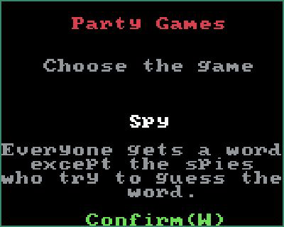

# Party Games for Sprig

A pass-the-console party game for friends in the same room. In **Spy**, everyone privately sees the same word except the spies. Take turns giving clues while the spies try to work out the word before the two-minute discussion timer ends.

**[Play the original gallery version](https://sprig.hackclub.com/gallery/Party_Games)** · **[Merged upstream contribution #1805](https://github.com/hackclub/sprig/pull/1805)** · **[Current game source](Party%20Games.js)**



The walkthrough shows the current repository version, manually stepped through in the actual Sprig editor. Frames are held for readability; it is not a real-time recording or a physical-device capture. The gallery hosts the original 2024 upstream version; repository fixes reach that version only through a separate upstream update.

## Play the current version

1. Open the [Sprig gallery game](https://sprig.hackclub.com/gallery/Party_Games).
2. Replace the editor contents with `Party Games.js` from this repository and click **Run**.
3. Click the game screen to give it keyboard focus.
4. Press **W**, choose a format with **A / D**, and confirm with **I**.
5. Pass the console to each player. **K** reveals their role; another **K** hides it before passing on.
6. After the last reveal, discuss the word while the timer counts down. At time-up, use **I** for another round or **J** for the menu. **J** can also return to the menu during a round.

Keep each role reveal private. A keyboard is recommended for the browser version. Sprig hardware uses the corresponding labelled controls, but this maintenance pass was tested in the browser and simulated input tests, not on a physical console.

## Formats

| Players | Spies |
| --- | --- |
| 2–5 | 1 |
| 5–8 | 2 |

The menu has separate choices for five players with one or two spies. Spy is the implemented game. Party Bomb and Paranoia remain historical menu concepts in the source and are not advertised as playable modes.

## Engineering and history

The game is a standalone Sprig JavaScript file using map/bitmap assets, text screens, input callbacks, randomized role assignment, and a timed round. It needs the Sprig runtime; it is not a Node command-line game.

The original artwork/game was [merged into Hack Club's Sprig gallery in June 2024](https://github.com/hackclub/sprig/pull/1805). This repository remains the development home. The maintenance pass fixes off-by-one player counts, the one/two-spy boundary, menu navigation bounds, and repeated input-handler/timer lifecycle issues.

`gameCode.txt` is a historical plain-text mirror, kept byte-identical to `Party Games.js`. `words.txt` and `centerTextScript.py` are word-list preparation materials.

## Development checks

Node.js 20+ is sufficient for the checks; no npm packages are required.

```sh
node --check "Party Games.js"
node --test tests/*.test.cjs
```

The tests drive the actual game script through a small Sprig API harness. They verify every advertised player/spy format, reveal counts, menu bounds, timer cancellation/restart, one handler per input, and source/mirror consistency. CI repeats these checks. The browser walkthrough separately verifies rendering in the real runtime.

## License and credits

[Apache License 2.0](LICENSE). Game by [iambodha](https://github.com/iambodha), built for [Hack Club Sprig](https://github.com/hackclub/sprig).
